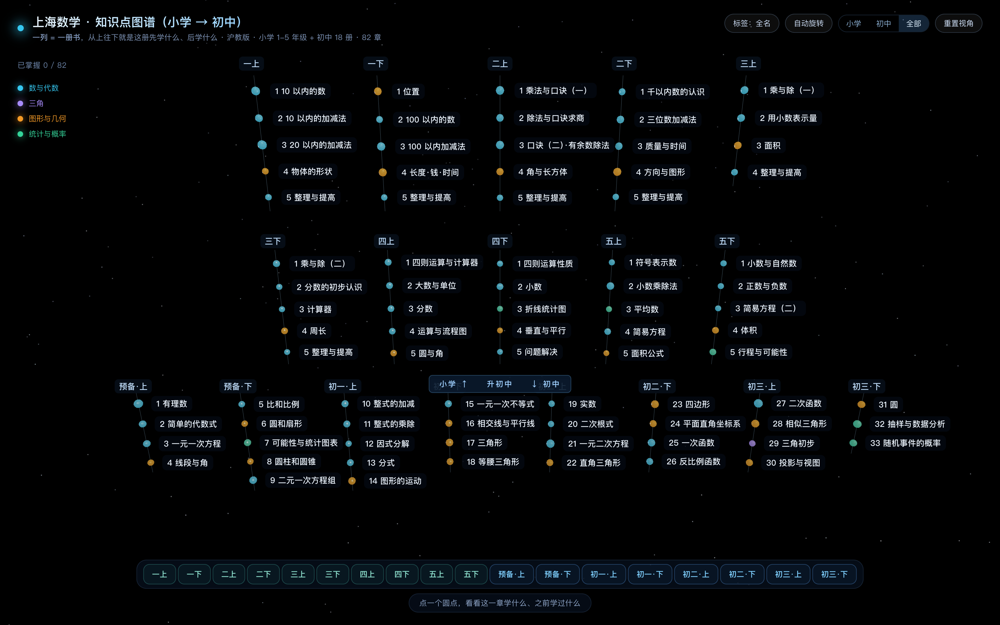
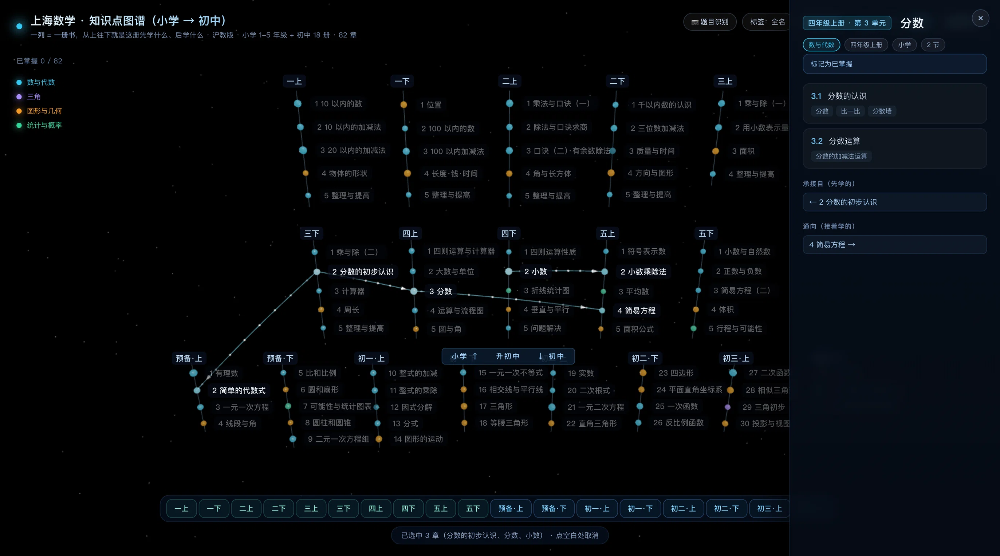
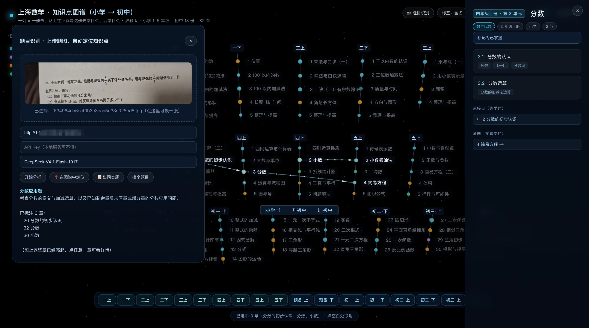

# 上海数学 · 知识点图谱 3D

同为宝爸，很清楚陪娃学习的焦虑与辛苦。我为自家孩子梳理了知识点串联笔记，在此分享。

—— 霜枫燃

沪教版小学数学 1–5 年级 + 初中 18 册、82 章的知识图谱，用 three.js 渲染成可旋转的 3D 星图。

**一个 HTML 文件，双击就能打开**——不需要服务器、不需要联网、不依赖 CDN。



选中一章时，右侧面板列出这章的知识点和它「承接自 / 通向」的章节，图上只亮起相关的线：



上传题目图片，面板会自动标出这道题涉及哪几章，可以一键跳到图谱上定位：



## 特点

- **一列一册书**：竖列是册，自上而下是这一册的单元顺序，横排是学期先后（一上 → 三下 → 四上 …，中间一条分界标出「小学 ↑ 升初中 ↓ 初中」）
- **节点 = 一章**，颜色按领域区分：数与代数 / 图形与几何 / 统计与概率 / 三角
- **关系线只在你需要时出现**：点任意一章，它「承接自」和「通向」的线才亮起，末端有箭头、线上有 8 个流动光点表示方向；**不点就一条线都不画**，画面保持干净，不会出现莫名其妙的淡线
- **掌握度标记**：点章 → 面板里标「已掌握」，节点出现金色光环 + ✓，底部每册的进度条和左上角 `已掌握 N / 82` 实时更新，标记存在浏览器本地，关掉再开还在
- **上传题目图片 → 自动定位知识点**：把题图拖进识别面板，调用任意 OpenAI 兼容的视觉模型，自动标出这道题涉及哪几章，可一键跳到图谱对应位置
- **出同类题**：基于原题和它标注的章节，让模型出两道同类型练习（含答案与思路）
- **学段切换**：小学 / 初中 / 全部三档，也支持 `?stage=primary` 深链
- **深链定位**：`#ch=124,125` 直接高亮指定的章节（可多章）
- **自适应取景**：窗口大小变化时自动重新计算相机距离，内容不会被底部导航条压住

## 使用

```bash
git clone <repo>
open 上海初中数学知识图谱_3D.html     # macOS
# 或直接把文件拖进浏览器
```

## 题目识别配置

打开右上角「📷 题目识别」，填三个字段（填一次会存在浏览器里）：

| 字段 | 说明 |
|---|---|
| API 地址 | 任意 OpenAI 兼容接口，如 `https://api.openai.com/v1`、`https://dashscope.aliyuncs.com/compatible-mode/v1` |
| API Key | 本地/局域网服务可留空 |
| 模型名 | 必须是**支持图片输入**的模型，如 `gpt-4o`、`qwen-vl-max`、`glm-4v-plus` |

请求里固定带 `chat_template_kwargs: { thinking: false }`——vLLM 部署的推理模型可以直接关掉思考链，从几十秒降到几秒。

> ⚠️ 页面是 `file://` 打开的，调外部接口需要对方允许跨域（CORS）。OpenAI / 通义 / 智谱都允许浏览器直连；自建服务需要加 `Access-Control-Allow-Origin`。

## 数据

- **各册的单元名**：来自沪教版教材目录
- **每章的知识点、章节之间的承接关系**：按教材编排与教学顺序整理
- 关系边共 52 条——不少章确实没有跨章依赖（比如「10 以内的数」是整张图的起点）

## 技术实现

- **three.js r187**，ESM 版本直接内联进 HTML（`three.core.js` + `three.module.js`，Blob URL 动态 import），无 CDN 依赖
- **WebGL2 + 自写 orbit 相机**：不依赖任何 addons，旋转 / 缩放 / 惯性都是自己算的
- **文字标签用 DOM 叠加**，每帧做一次 `Vector3.project()` 投影——任何缩放下文字都清晰，不受 3D 渲染分辨率影响
- **连线**：二次贝塞尔曲线 + TubeGeometry，末端 Cone 箭头，8 个沿曲线分布的光点；只在被选中时可见，未选中时连位置计算都跳过

## 目录

```
上海初中数学知识图谱_3D.html   成品（单文件，约 2.2 MB，直接打开）
src/template.html              HTML / CSS 模板
src/scene.js                   three.js 场景、交互、题目识别逻辑
src/graph_data.json            章节 / 知识点 / 关系数据（82 章 / 52 条边）
src/build.py                   构建脚本：把上面几样合成单个 HTML
```

重新构建：

```bash
python3 src/build.py
```

## 许可

- 本项目代码：MIT
- 内联的 three.js：MIT（© three.js authors）
- 教材目录与知识点整理：本项目整理
